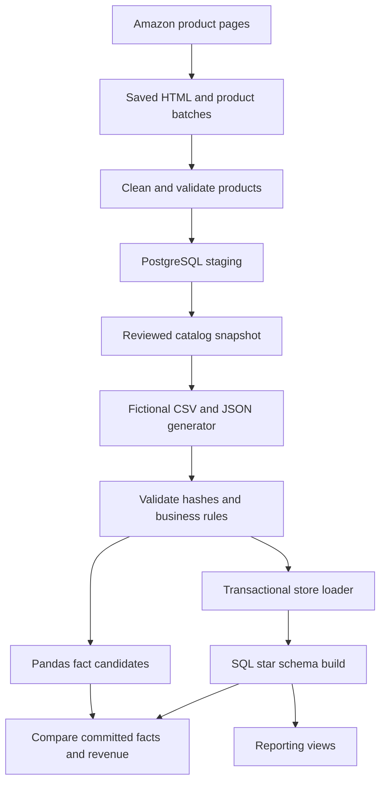

# Architecture

Live collection and catalog review precede the store pipeline. The manual incremental Airflow DAG orchestrates generation, validation, transformation, source/warehouse loading and read-only verification. Its Extract stage does not request fresh Amazon pages. Separate Airflow metadata PostgreSQL stores orchestration state; the project database stores staging, store and warehouse schemas.

Raw files carry batch/run identity and manifests. Loader transactions protect source integrity; warehouse transactions protect facts/dimensions. A committed source batch can be followed by a resumed warehouse build. Read-only recovery checks compare counts, revenue, provenance and pipeline state and do not constitute a byte comparison of every business row.
