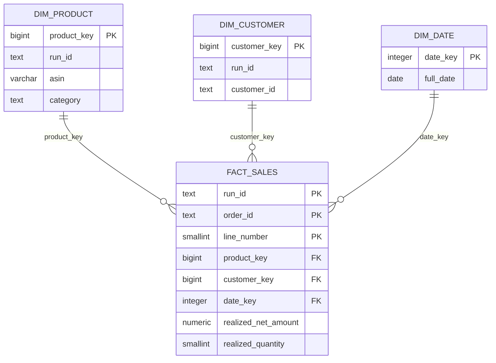
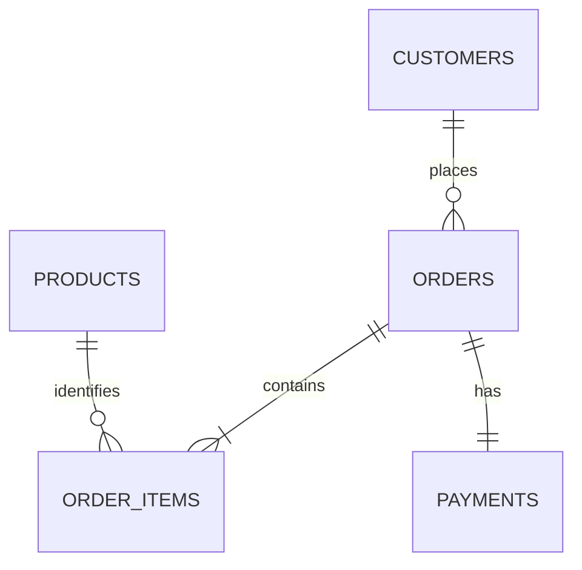

# Logical model

Fact grain: one order line, keyed by `(run_id, order_id, line_number)`. All statuses are retained; realized measures are zero unless completed.

Product/customer foreign keys are composite with run_id, preventing cross-run joins. Date is a shared dense UTC calendar. See `sql/005_warehouse_schema.sql` for all constraints, columns, indexes and reporting views.

Store relationships are scoped by run_id. Products retain observed source metadata separately from simulation anchors. Ingestion/incremental ledgers record hashes and committed counts; pipeline_state stores the committed watermark and ID maxima.
