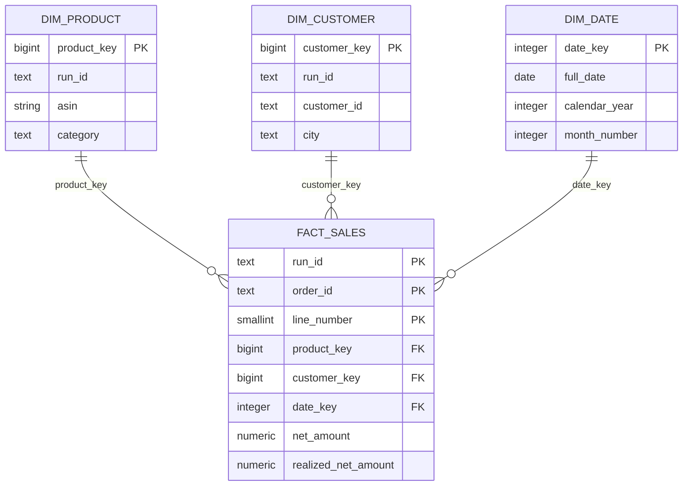

# Sales warehouse v1.0.0

Merge the package src and sql folders into the existing project root. Requires the previously delivered load_store_data.py and generator validation modules to remain in src/load and src/generate. No additional dependencies beyond psycopg[binary] and python-dotenv.

Run from VS Code PowerShell in the project root:

```powershell
.\.venv\Scripts\python.exe src/warehouse/build_warehouse.py --run-id store_v1
```

Repeat the identical command. Expected first status: built. Expected repeat: already_built and all rows_added values zero. Every repeat still checks source tables, warehouse row counts, dimensions, line-level values and revenue. A changed source manifest or incompatible model version is refused. Existing dimensions/facts are not overwritten. Quality failures roll back the entire transaction. Only warehouse tables are created/modified; store/staging tables are read.

## Grain and relationships

FactSales has exactly one row per (run_id, order_id, line_number). All statuses are retained. Quantity describes ordered units; realized_quantity and realized_net_amount are zero for cancelled/payment_failed orders. Completed lines retain their net amount as realized simulated item revenue.

| Guideline entity | PostgreSQL table | Key |
| --- | --- | --- |
| DimProduct | warehouse.dim_product | product_key surrogate, unique run_id + ASIN |
| DimCustomer | warehouse.dim_customer | customer_key surrogate, unique run_id + customer_id |
| DimDate | warehouse.dim_date | integer YYYYMMDD, one row per calendar date |
| FactSales | warehouse.fact_sales | run_id + order_id + line_number |



Dimension joins also enforce run_id to prevent cross-run relationships. Date keys use the UTC order date regardless of PostgreSQL session timezone. The date dimension contains every day in the source order date range, including days without sales. Product/customer snapshots are immutable per run, not SCD Type 2 history. New repeated run IDs are not incremental sales ingestion. Surrogate keys are warehouse identifiers and need not equal or match their business keys.

For store_v1 expect 1623 product dimension rows, 100000 customer dimension rows and 1000000 fact rows. The order date range should cover 659 calendar dates (2025-01-01 through 2026-10-21). Date rows are shared globally; the report counts dates within the current run range, not all date rows across future runs. There should be 400000 distinct order IDs.

Expected realized item revenue for the already generated store_v1: EGP 3932789464.25. This is fictional sales value, not actual Amazon revenue. Do not sum net_amount across all statuses when reporting realized revenue. Prefer realized_net_amount. The model omits order-level shipping from the line fact to avoid fan-out duplication. Analyze shipping and payment totals at store.orders/store.payments grain. Do not multiply these totals by joining to line items.

## Provenance

Source observed prices/ratings/counts remain nullable in DimProduct. Simulation price anchors/methods are distinct fields. Source titles support project categories; categories are not authoritative Amazon metadata. Order-line prices and all customers/transactions are synthetic. Newer observed product prices are not applied retroactively to this run snapshot. No historical product availability is inferred from order dates.

## Views

warehouse.v_sales_detail joins each fact to the three dimensions, retaining run_id and is_synthetic.

warehouse.v_monthly_category_sales groups realized item revenue and units by run/currency/month/category. completed_orders_in_category is a DISTINCT order count within each category; an order with multiple categories appears in several category groups. Do not sum that column to obtain total store orders. For total orders, use COUNT(DISTINCT order_id) on the fact at the desired scope.

Filter by run_id when querying. Two separately generated runs currently restart natural customer/order IDs and may describe duplicate simulated business activity. Do not combine them as incremental sales batches. A later module will handle disjoint incremental inputs explicitly.

## Checks and execution

The builder uses the same project advisory lock as the store loader, an existing source ingestion record, and one transaction. It validates source counts/amounts first, creates schema/views, inserts missing dimension/fact keys, then checks:

- Exact product/customer/fact counts against source manifest.
- Continuous date range with correct calendar and ISO attributes.
- NULL-safe equality of every dimension snapshot and every fact measure/key/status to source.
- Unique fact grain, product/customer/date foreign keys and per-line arithmetic constraints.
- Distinct order count and equality of realized fact revenue to completed order net_items_amount.

No deletes, truncation or updates to existing business rows occur. The build metadata checked_at_utc timestamp is refreshed after successful verification. A mismatch fails instead of silently rewriting history. Source table membership in staging.products is verified by the existing store checker.

sql/005_warehouse_schema.sql defines the model. sql/006_build_warehouse.sql performs inserts. sql/007_warehouse_quality.sql validates exact values. Run the Python entry point so the transaction context is set up correctly; do not run those three scripts manually as standalone batches. sql/008_warehouse_review.sql contains optional read-only analysis queries.

## Validation performed during preparation

PostgreSQL syntax parsed for every supplied schema/transform/quality statement and every SQL statement issued by the Python driver. The actual SQL model and transformations were executed against a PGlite PostgreSQL engine with three source orders covering completed/cancelled/payment_failed statuses and seven product lines. Checks passed for first build, repeat with zero added rows, exact revenue and monthly-view reconciliation, detection of a changed product category, rejection of invalid realized revenue and invalid foreign keys. Python orchestration paths were exercised with a cursor test double for new build, repeat, quality failure and incompatible model version.

This is a small SQL integration fixture, not a full million-row benchmark or a test of the user's Docker PostgreSQL connection. The run on your machine is the full-size integration check.

## Next steps

After this build succeeds and its repeat adds zero rows: implement disjoint incremental input batches and watermark rules; assemble Airflow DAG stages/logging/retries; add required quality/test evidence, GitHub CI and final project documentation. The current per-run key handling and idempotent rebuild are not yet a complete incremental ingestion implementation.
